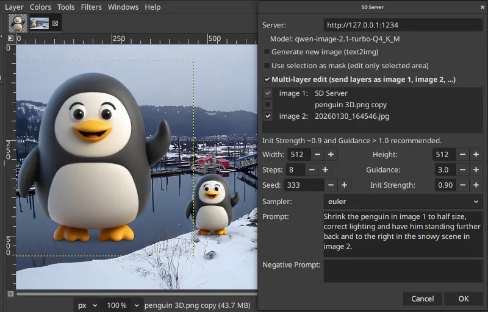

# GIMP 3 AI Plugins


A collection of Python-based AI plugins for **GIMP 3** (GNU Image Manipulation Program), using the GIMP 3 Python API via PyGObject introspection.

## Plugins

| Plugin | What it does | How it works | Dependencies |
|--------|-------------|--------------|--------------|
| **Background Remove** (`bgremove/`) | Removes backgrounds from images using AI | Exports layer → runs `backgroundremover` CLI → imports result as new transparent layer | `backgroundremover` (PyPI) |
| **AI Upscale** (`upscale/`) | Upscales images 4× using AI upscalers | Exports layer → runs PyTorch upscaler (3 backends) → imports result as new upscaled layer | `torch`, `pillow`, `image_gen_aux` / `diffusers` |
| **Depth Map** (`depthmap/`) | Creates a depth map layer from the active layer | Exports layer → runs Depth Anything V2 in-process (Small / Base / Large) → imports result as new depth layer; optional Facebook 3D photo export | `depth-anything-v2`, `torch`, `torchvision`, `opencv-python`, `matplotlib` |
| **AI Edit** (`aiedit/`) | Edits images using text prompts via a diffusion model and vision LLM | Exports layer → runs `sd-cli` with a diffusion GGUF model + vision LLM → imports edited result as new layer | `sd-cli` (stable-diffusion.cpp), diffusion GGUF, vision LLM GGUF, VAE |
| **SD Server** (`sd-server/`) | Generates/edits images via stable-diffusion.cpp server API | Connects to `sd-server` HTTP API; supports txt2img, img2img, and Kontext/Boogu-style reference editing | `sd-server` (stable-diffusion.cpp), `requests` |

## Security

**Arbitrary command execution.** Plugins for most applications can run any commands. This is not new. Open source relies on the community to find and fix bugs and exploits. You should always review new source code or test in a sandbox.

Don't download from untrusted places. The official location for these plugins is https://github.com/themanyone/gimp-plugins

## Requirements

- **GIMP 3.0+** — these plugins use the GIMP 3 Python API (`gi.require_version('Gimp', '3.0')`)
- **Python 3** — GIMP 3 ships with its own Python environment
- **GPU Acceleration** — e.g. CUDA strongly recommended for the upscale, image edit plugins.

## Installation

**Installer.** The `install.py` installer (experimental) will attempt to install missing dependencies and put things in the right places. If something is not right, check Manual Install steps below & [report issues](https://github.com/themanyone/gimp-plugins/issues).

### 3. Restart GIMP

After restart, plugins appear in the GIMP menus:
- **AI Image**: File → Create → AI Image...
- **Background Remove**: Filters → AI → Remove Background...
- **AI Upscale**: Filters → AI → Upscale...
- **AI Edit**: Filters → AI → AI Edit...
- **SD Server**: Filters → AI → SD Server...

**Keyboard Shortcuts.** Go to Edit -> Keyboard Shortcuts and type the name of the plugin.

## Manual Install
Developers & power users may want fine-grained control & knowledge of install locations here:

**AI Edit**

The AI Edit plugin uses `sd-cli` from stable-diffusion.cpp (not a Python package). See [aiedit/README.md](aiedit/README.md) for model downloads and setup.

**Others.** Other plugins have their own Python dependencies. The installer will attempt to install these dependencies with `pip`.

```shell
# For Background Remove
pip install backgroundremover

# For AI Upscale
pip install image_gen_aux diffusers torch pillow

# For SD Server
pip install requests

# For Depth Map
pip install --no-deps depth-anything-v2 torch pillow
pip install opencv-python matplotlib  # only if not already installed
```

### 2. Place plugins in GIMP's plug-ins directory

The installer looks for the highest-numbered GIMP/xx.x/plug-ins directory. Install whichever plugins you need. If you have `sd-server` running, you might be able to get by with just `bgremove` and `sd-server` plugins.

```shell
git clone https://github.com/themanyone/gimp-plugins.git
cd gimp-plugins
ln -srf bgremove ~/.config/GIMP/3.2/plug-ins/
ln -srf sd-server ~/.config/GIMP/3.2/plug-ins/
# install additional plugins the same way
```

## Plugin architecture

Every plugin follows the same pattern:

```
export layer as temp PNG → process (CLI or ML) → load result → new layer → copy pixels
```

See [AGENTS.md](AGENTS.md) for the full architecture guide and development notes.

### SD Server

The SD Server plugin connects to a running `sd-server` instance from [stable-diffusion.cpp](https://github.com/leejet/stable-diffusion.cpp) via its HTTP API. It supports:

- **txt2img** — generate new images from a text prompt
- **img2img** — edit the current layer using a diffusion model
- **Reference-based editing** — Qwen Image 2.1, Kontext, Boogu, Z-Image models (uses `extra_images` for reference conditioning)

Start the server first, then use the plugin from GIMP:

```bash
# Qwen Image 2.1 Turbo with the Qwen3-VL 8B vision LLM (same files as AI Edit below)
sd-server \
  --diffusion-model ~/Downloads/src/ComfyUI/models/diffusion_models/qwen-image-2.1-turbo-Q4_K_M.gguf \
  --vae ~/Downloads/src/ComfyUI/models/vae/qwen_image_2.1_vae_bf16.safetensors \
  --llm ~/models/Qwen3-VL-8B-Instruct-UD-IQ3_XXS/Qwen3-VL-8B-Instruct-UD-IQ3_XXS.gguf \
  --llm_vision ~/models/Qwen3-VL-8B-Instruct-UD-IQ3_XXS/mmproj-F16.gguf \
  --diffusion-fa --offload-to-cpu -v
```

Swap in any other diffusion model, VAE and text encoder.

The plugin auto-detects the loaded model and available features via `/sdcpp/v1/capabilities`. The model name is shown in the dialog.

**API Compatibility.** Works with many servers that implement the stable-diffusion API:

| Endpoint | Purpose |
|----------|---------|
| `/sdapi/v1/txt2img` | Text-to-image generation |
| `/sdapi/v1/img2img` | Image-to-image / reference editing |
| `/sdcpp/v1/capabilities` | Model & feature detection |

**OpenAI-compatible servers.** The plugin can also connect to any OpenAI-compatible `/v1/images/generations` endpoint (not just `sd-server`) — just point the Server URL field to any compatible API.



**Multi-layer edit (object & style transfer).** With a reference-capable model (Qwen Image 2.1, Kontext, Boogu, Z-Image), tick **Multi-layer edit** in the dialog to send individual layers to the server as separate reference images. Each checked layer is labeled positionally (`image 1`, `image 2`, ...) in layer-stack order (topmost = `image 1`); the layer being edited is always included. Rename your layers so you can identify them in the list, then refer to them by number in the prompt:

- **Object transfer:** check the couch layer and the room layer, then prompt `Put the couch in image 1 into the room in image 2.`
- **Style transfer:** check the style source and the target, then prompt `Render image 2 in the style of image 1.`

Placing objects needs near-full **Init Strength** and **Guidance above 1.0**, so enabling multi-layer edit raises them (to 0.9 and 3.0) automatically — adjust as needed.


### Background Remove

- This works with existing tools.
- Let's assume you have installed `backgroundremover`.

Don't want to use `backgroundremover`?
- Install any old command-line AI tool to remove backgrounds from images.
- You can use `pip install rembg` for example.
- Edit `bgremove/bgremove.py` and modify the `command` list to use a different CLI tool (e.g., `rembg` instead of `backgroundremover`).

### AI Upscale

Try small images first. Then try 1024x1024 pixels to upscale to 4K resolution. Larger images will take a lot longer. And without enough VRAM upscale will fail.

The Upscale plugin prompts you to choose an AI model when you use the plugin in Gimp. And it allows you to save preferences. Models are downloaded automatically, so it might take some time to upscale your first image.

It is not necessary to edit `upscale/upscale.py` to:
- Change `DEFAULT_MODEL` or any key in `MODEL_CONFIGS`
- Add new upscaling models with appropriate config
- Tune inference parameters (tile_size, steps, noise_level, etc.)
...but you can!

### Depth Map

The Depth Map plugin creates a depth map layer (white = near, black = far) from the active layer using [Depth Anything V2](https://github.com/DepthAnything/Depth-Anything-V2), running in-process like `upscale`. Find it under Filters -> AI.

**Requirements.** `pip install --no-deps depth-anything-v2 torch pillow` plus `opencv-python` and `matplotlib`. Install with `--no-deps` because the package pins an old `torchvision` combo. A checkpoint (`depth_anything_v2_vit[sbl].pth`) is also needed; the Small (~98 MB), Base (~390 MB), and Large (~1.3 GB) variants match three model sizes, with the model cache avoiding reloads between runs. GPU (CUDA) is used when available, with a CPU fallback.

**It works automatically.** Just pick a variant and output (grayscale, colored inferno, or both) in the dialog and click OK. The plugin locates an existing checkpoint via `locate` and common model directories (`~/models`, `~/Downloads`, `~/Downloads/src/ComfyUI/models`, `/opt/models`), or auto-downloads the chosen variant into `~/.cache/gimp-depthmap/`. It resolves a usable model in this order: explicit path in the dialog → discovered checkpoint on disk → download. Alternatively, tick **Export as 3D photo (Facebook)** to also write `<name>.jpg` plus `<name>_depth.jpg` for upload to Facebook.

**Troubleshooting.** First run can take a while because the checkpoint downloads. If nothing is found, disable **Download if missing** and enter the checkpoint path directly, or fetch one manually with `hf download depth-anything/Depth-Anything-V2-Small --local-dir ~/.cache/gimp-depthmap`. Depth Anything V1 checkpoints (`depth_anything_vitl14.pth`) are not supported. If a model file is missing the plugin says so; install errors usually mean `depth-anything-v2` was installed with its pinned old `torchvision`. If the 3D photo parallax looks inverted, rerun with **Invert (for lens blur)**.

### AI Image

The `aiimage` plugin calls `sd-cli` from the command line. It's a bit more complicated to use. But it offers more flexibility and of course it doesn't require a server. Find the AI Image dialog under File -> Create.

Edit [aiimage.py](aiimage/aiimage.py) and set `MODELS_PATH` and `LLM_PATH` to where your models are. Or just enter the full path to each model into the dialog at runtime and save preferences. We are reusing our ComfyUI models but yours will be somewhere else.

**Qwen Image 2.1 Turbo (default).**

Text-to-image with the same models as AI Edit (see below). It only needs 8 steps at CFG scale 1.0 with the Turbo sigma schedule. Download them with the `hf download` commands in the AI Edit section; the defaults are:

```python
DEFAULT_DIFFUSION_MODEL = MODELS_PATH + "/diffusion_models/qwen-image-2.1-turbo-Q4_K_M.gguf"
DEFAULT_LLM = LLM_PATH + "/Qwen3-VL-8B-Instruct-UD-IQ3_XXS.gguf"
DEFAULT_LLM_VISION = LLM_PATH + "/mmproj-F16.gguf"
DEFAULT_VAE = MODELS_PATH + "/vae/qwen_image_2.1_vae_bf16.safetensors"
```

**Z Image Turbo (alternative).**

Z Image Turbo is for fast image generation in 4-6 steps. Enter these model locations into the dialog and save a preset:

```python
DEFAULT_DIFFUSION_MODEL = MODELS_PATH + "/diffusion_models/z-image-turbo-Q5_K_M.gguf"
DEFAULT_LLM = MODELS_PATH + "/text_encoders/qwen_3_4b.safetensors"
DEFAULT_LLM_VISION = ""
DEFAULT_VAE = MODELS_PATH + "/vae/ae.safetensors"
```

### AI Edit

Like `aiimage` the `aiedit` plugin calls `sd-cli` from the command line. It's good for simple, single-layer edits. Find the AI Edit plugin under Filters -> AI.

Scale images down to 256x256 or lower for testing AI Edit. Editing large images takes longer. Default model paths may be edited into the top of `aiedit/aiedit.py` or enter the paths into the dialog at run time.

**Qwen Image 2.1 Turbo (default).**

This is the default AI Edit model. It edits the current image from a text prompt, using the source image as a reference (`-r`) together with the Qwen3-VL vision LLM. It is a distilled model, so it only needs 8 steps at CFG scale 1.0; the plugin selects reference editing and the fixed Turbo sigma schedule automatically.

Download the four files with the [Hugging Face CLI](https://huggingface.co/docs/huggingface_hub/guides/cli) (`pip install -U "huggingface_hub[cli]"`, or `curl -LsSf https://hf.co/cli/install.sh | bash`):

```shell
# Diffusion model: Qwen Image 2.1 Turbo, Q4_K_M GGUF
hf download unsloth/Qwen-Image-2.1-Turbo-GGUF qwen-image-2.1-turbo-Q4_K_M.gguf \
  --local-dir ~/Downloads/src/ComfyUI/models/diffusion_models

# Vision LLM and its mmproj projector: Qwen3-VL 8B
hf download unsloth/Qwen3-VL-8B-Instruct-GGUF \
  Qwen3-VL-8B-Instruct-UD-IQ3_XXS.gguf mmproj-F16.gguf \
  --local-dir ~/models/Qwen3-VL-8B-Instruct-UD-IQ3_XXS

# VAE
hf download Comfy-Org/Qwen-Image-2.1 vae/qwen_image_2.1_vae_bf16.safetensors \
  --local-dir ~/Downloads/src/ComfyUI/models
```

These are the defaults at the top of `aiedit/aiedit.py`. Set `MODELS_PATH` and `LLM_PATH` for your machine, or enter the paths in the dialog:

```python
DEFAULT_DIFFUSION_MODEL = MODELS_PATH + "/diffusion_models/qwen-image-2.1-turbo-Q4_K_M.gguf"
DEFAULT_LLM = LLM_PATH + "/Qwen3-VL-8B-Instruct-UD-IQ3_XXS.gguf"
DEFAULT_LLM_VISION = LLM_PATH + "/mmproj-F16.gguf"
DEFAULT_VAE = MODELS_PATH + "/vae/qwen_image_2.1_vae_bf16.safetensors"
```

Pick the **Default** preset in the dialog to load these, along with 8 steps, CFG scale 1.0 and the Turbo sigma schedule.

**Boogu Edit.**

This is a Kontext model. Kontext mode should be set automatically, and Guidance will be set to 0.0. You can change them but it is not recommended. You can also create new images with these. This model has worked well for adding characters and text to images.

```python
DEFAULT_DIFFUSION_MODEL = MODELS_PATH + "/diffusion_models/boogu-edit-dit-Q4_0.gguf"
DEFAULT_LLM = LLM_PATH + "/Qwen3-VL-8B-Instruct-UD-IQ3_XXS.gguf"
DEFAULT_LLM_VISION = LLM_PATH + "/mmproj-F16.gguf"
DEFAULT_VAE = MODELS_PATH + "/vae/ae.safetensors"
```

**Flux 2 Klein.**

This is an older & smaller img2img model. But it should work. Img2img mode should be set, and Guidance set to 3.5. Download these models and enter their locations into the image editing dialog and save it.

```python
diffusion model: flux-2-klein-4b-Q4_K_S.gguf
clip_l: clip_l.safetensors
llm: Qwen3-4B-Instruct-2507-UD-Q4_K_XL.gguf
vae: flux2-vae.safetensors"

```

**Customizing.**

Presets are saved in `~/.config/gimp-plugins/aiedit/presets.json` but you can load, save, and rename settings at runtime. You may also modify these plugins to show different defaults if you want.

## License

This software is Copyright (2026) by **Henry Kroll III** ([@themanyone](https://github.com/themanyone)) under [GNU General Public License v3.0](LICENSE)

    This program is free software: you can redistribute it and/or modify
    it under the terms of the GNU General Public License as published by
    the Free Software Foundation, either version 3 of the License, or
    (at your option) any later version.

    This program is distributed in the hope that it will be useful,
    but WITHOUT ANY WARRANTY; without even the implied warranty of
    MERCHANTABILITY or FITNESS FOR A PARTICULAR PURPOSE.  See the
    [GNU General Public License](LICENSE) for more details.

    You should have received a copy of the GNU General Public License
    along with this program.  If not, see <https://www.gnu.org/licenses/>.

For any other uses, contact the author.

## Author

**Henry Kroll III** ([@themanyone](https://github.com/themanyone))

## Thanks for trying out gimp-plugins!
* GitHub https://github.com/themanyone
* YouTube https://www.youtube.com/themanyone
* Mastodon https://mastodon.social/@themanyone
* Linkedin https://www.linkedin.com/in/henry-kroll-iii-93860426/
* Buy me a coffee https://buymeacoffee.com/isreality
* TheNerdShow.com https://thenerdshow.com

